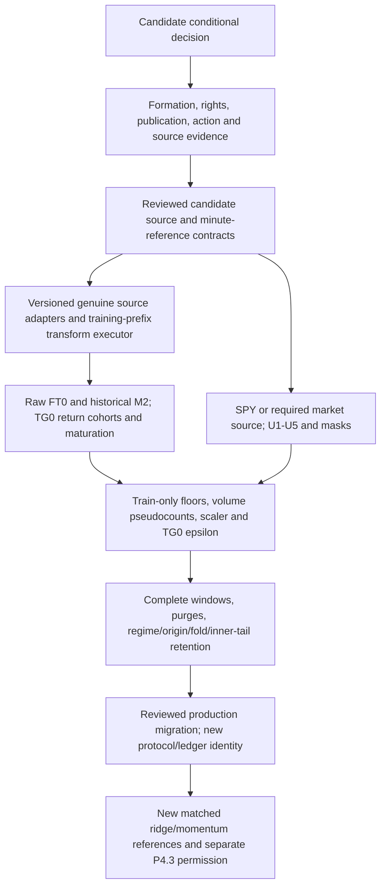

# D1 migration dependencies v1 — no migration executed

Decision TA-D1-CORE5-CONDITIONAL-2026-10-14-v1 accepts the candidate only. Production remains AAPL/JPM/JNJ/WMT/CAT. Every later migration must bind the exact new decision, universe order, data/code/clock/action/fit-population versions and demonstrate old-artifact rejection.

| Object | Required recomputation / invalidation |
|---|---|
| Immutable raw stock/SPY/course archives | Reuse exact verified references; no copies or in-place rewriting. New legitimately acquired minutes/actions are distinct immutable source versions. |
| Stock FT0 | Reconstruct via existing 16 formulas and 48 scheduled steps. Bind stock order, source/available_at/action units, calendar and each training-prefix certificate. AAPL raw components can be reused only with identical inputs and verified independence; new universe/population identities must be reissued. |
| M2 | Rebuild genuine origin-matched historical minute-reference returns and their maturity at every own-step cutoff. Refit its origin-balanced train-only floor/scale under the new certified population. No hourly proxy mislabeled as minute truth. |
| T2/daily histories | Revalidate genuine full-session closes and prior-only state, including terminal stub; source presence alone is not actual feature validity. |
| TG0 | Recompute all five returns, median and unscaled MAD, then epsilon=max(1e-4,0.1 median of training origin MAD). Changing the peer set changes every target cross-section, including AAPL. Refit separately for inner calibration and full refit; purge unmatured labels. |
| U1–U5 | Formula and one-shared-market-table invariant remain. Revalidate source/clock/daily-close/action contract; rebuild floors/scalers and eligible market keys per permitted fit prefix where any binding/population changes. Reuse numerically identical immutable market primitives only with explicit identical-input evidence, never five stock copies. |
| Stock/market scalers and floors | Fit only unique canonical permitted training keys, not repeated 48-step windows or development. Rebuild feature values if fitted floors/pseudocounts change their basis. Old certificates cannot be renamed. |
| Peer summaries and H/L | Recompute target-excluding peers, canonical ordering and formation-only volume identities. Existing retrospective formation means would suggest AAPL/CME as extremes only if that proxy is explicitly accepted; no H/L identity is activated now. |
| Retention and samples | Recompute complete 48×16×5, market endpoint/46-of-48 and common matched population; exact maturity, split boundaries, each fold/origin/regime and 63-session inner tails. Calendar bounds are not replacement denominators. |
| Baselines/models/checkpoints | New input/target/scale/population identities invalidate old ridge, neural checkpoints and authoritative forecasts. Fit references/models only under separately scoped authority. No baseline or neural fit here. |
| Reference clocks and accounting | Bind raw versus split-share units, dividends/pay dates, minute reference versus actual fill and approved proxy/exception policy. Revalidate shared/cost/borrow/benchmark assumptions; no economic replay here. |
| CURRENT_PROTOCOL and science ledger | Human-reviewed migration must specify new protocol identity and append-only history continuity; no current pointer/default or event identity changes except this authorized conditional decision append. |

Candidate diagnostic preparation may occur in its isolated namespace after indispensable evidence passes; production pointer activation is not a prerequisite merely to inspect genuine candidate source keys. Conversely, candidate acceptance is not a source certificate or model permission.
