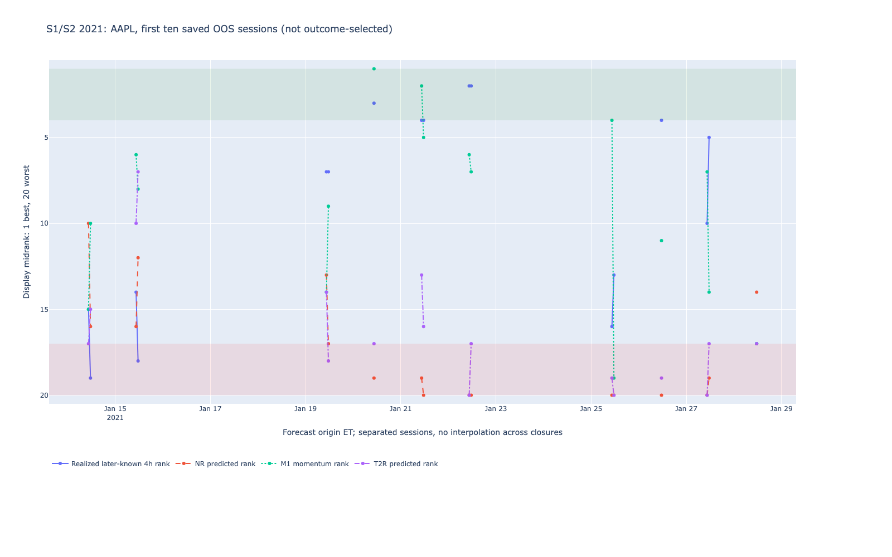
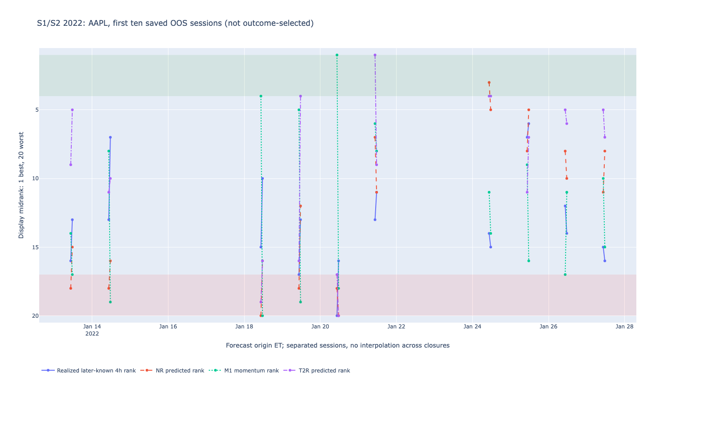
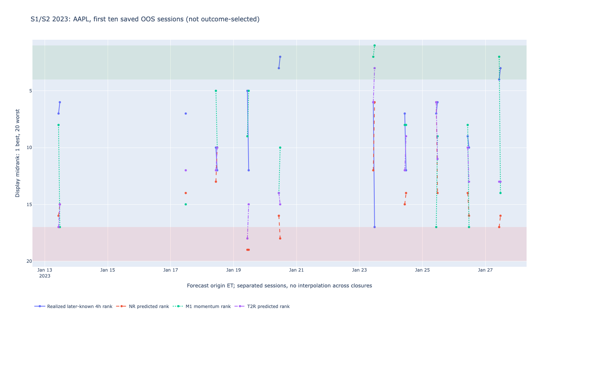
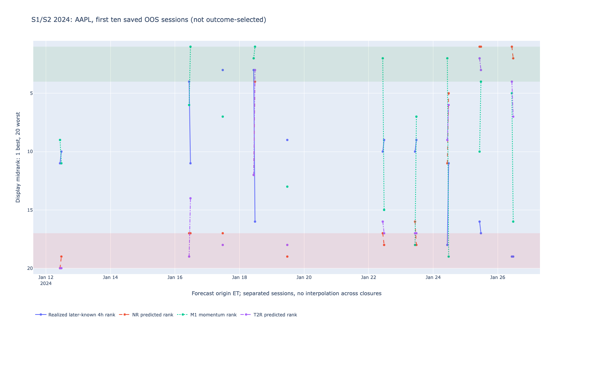

# Historical S1 + S2 ranking visual diagnostics

**Retrospective saved-output analysis; no new fitting.** All31 accepted model-fold
outputs reconcile on exact keys, returns, target operands, weights and displayed
midranks. F21 PW failed and LP has no accepted OOS output; neither is backfilled.

Open [the offline interactive dashboard](plots/historical_s1_s2_rankings.html).
Choose year, primary model, extra overlays, stocks, dates and scatter origin.
The initial view is AAPL and the first ten actually saved OOS sessions in that year,
chosen independently of outcomes. Full-year access uses the Full saved year button.
The role selector changes the archived role metrics and cohort panels; trajectories
always remain genuine outer OOS. Rank1 means best, with exact average ties and no jitter.
Realized ranks are later-known outcomes attached to earlier forecast times.

The24 panels cover trajectories; identical-key predicted/realized/M1 heatmaps;
origin scatter; annual/equal-year, monthly and session IC with counts;
whole-month descriptive intervals; retrieval/concordance; signed/absolute movement
separately within/across sessions; top/bottom selection Jaccard; rank confusion;
stock/slot/quality rank error; margins/ties; score/residual/outcome distributions;
actual-objective tail cohorts; T2R original-target energy decomposition;
dropout-ON training and dropout-OFF validation selection. Gaps are never interpolated.
Set ties that do not identify exactly four names are marked ambiguous and excluded
from set-Jaccard histograms. Selection churn is not trading turnover or a position rule.

## Results and interpretation

The original primary population gives M1 equal-year IC0.0117255, T2R0.0076733,
NR0.0023695 and LR0.0060425. These are weak associations with substantial temporal
variation, not a reliable neural advantage over M1. A visually stable forecast ranking
does not establish accuracy. Retrieval20% and pair concordance50% are orientation
references, not significance tests; repeated stocks, pairs and origins are dependent.
PW's missing2021 output makes a four-year PW aggregate unavailable.
N0 is constant and its IC is undefined, not zero.

| model | 2021 | 2022 | 2023 | 2024 | equal_year |
| --- | --- | --- | --- | --- | --- |
| LR | 0.0215872 | -0.002914377 | 0.01286957 | -0.007372565 | 0.006042457 |
| N0 | nan | nan | nan | nan | nan |
| N1 | 0.01910849 | 0.002619969 | 0.01673101 | 0.00844253 | 0.0117255 |
| N2 | -0.01910849 | -0.002619969 | -0.01673101 | -0.00844253 | -0.0117255 |
| NR | 0.01851629 | -0.00988219 | 0.01111004 | -0.01026601 | 0.002369531 |
| P | -0.02827002 | -0.007668944 | 0.01836232 | 0.02011702 | 0.0006350939 |
| PW | nan | 0.009431709 | 0.01567839 | -0.01520033 | nan |
| T2R | 0.01379357 | 0.01179674 | 0.01844521 | -0.01334235 | 0.007673292 |

## Actual saved support

| year | origins | sessions | rows |
| --- | --- | --- | --- |
| 2021 | 293 | 177 | 5860 |
| 2022 | 364 | 203 | 7280 |
| 2023 | 284 | 172 | 5680 |
| 2024 | 308 | 185 | 6160 |

## Complete model/run inventory

| year | model | run_id | status | phase | evaluation_role | reason |
| --- | --- | --- | --- | --- | --- | --- |
| 2021 | N0 | F21_S1_N0 | PASS | refit | oos | nan |
| 2021 | N1 | F21_S1_N1 | PASS | refit | oos | nan |
| 2021 | N2 | F21_S1_N2 | PASS | refit | oos | nan |
| 2021 | P | F21_S1_P | PASS | refit | oos | nan |
| 2021 | LR | F21_S1_LR | PASS | refit | oos | nan |
| 2021 | LP | F21_S1_LP | DEFERRED | refit | oos | LP original failed attempt8; no accepted OOS and no retry |
| 2021 | T2R | HF20-S1S2-F21-T2R-S42 | PASS | refit | oos | nan |
| 2021 | NR | HF20-S1S2-F21-NR-S42 | PASS | refit | oos | nan |
| 2021 | PW | HF20-S1S2-F21-PW-S42 | FAILED | refit | oos | F21 PW failed start65; no accepted OOS |
| 2022 | N0 | F22_S1_N0 | PASS | refit | oos | nan |
| 2022 | N1 | F22_S1_N1 | PASS | refit | oos | nan |
| 2022 | N2 | F22_S1_N2 | PASS | refit | oos | nan |
| 2022 | P | F22_S1_P | PASS | refit | oos | nan |
| 2022 | LR | F22_S1_LR | PASS | refit | oos | nan |
| 2022 | LP | F22_S1_LP | DEFERRED | refit | oos | LP original failed attempt8; no accepted OOS and no retry |
| 2022 | T2R | HF20-S1S2-F22-T2R-S42 | PASS | refit | oos | nan |
| 2022 | NR | HF20-S1S2-F22-NR-S42 | PASS | refit | oos | nan |
| 2022 | PW | HF20-S1S2-F22-PW-S42 | PASS | refit | oos | nan |
| 2023 | N0 | F23_S1_N0 | PASS | refit | oos | nan |
| 2023 | N1 | F23_S1_N1 | PASS | refit | oos | nan |
| 2023 | N2 | F23_S1_N2 | PASS | refit | oos | nan |
| 2023 | P | F23_S1_P | PASS | refit | oos | nan |
| 2023 | LR | F23_S1_LR | PASS | refit | oos | nan |
| 2023 | LP | F23_S1_LP | DEFERRED | refit | oos | LP original failed attempt8; no accepted OOS and no retry |
| 2023 | T2R | HF20-S1S2-F23-T2R-S42 | PASS | refit | oos | nan |
| 2023 | NR | HF20-S1S2-F23-NR-S42 | PASS | refit | oos | nan |
| 2023 | PW | HF20-S1S2-F23-PW-S42 | PASS | refit | oos | nan |
| 2024 | N0 | F24_S1_N0 | PASS | refit | oos | nan |
| 2024 | N1 | F24_S1_N1 | PASS | refit | oos | nan |
| 2024 | N2 | F24_S1_N2 | PASS | refit | oos | nan |
| 2024 | P | F24_S1_P | PASS | refit | oos | nan |
| 2024 | LR | F24_S1_LR | PASS | refit | oos | nan |
| 2024 | LP | F24_S1_LP | DEFERRED | refit | oos | LP original failed attempt8; no accepted OOS and no retry |
| 2024 | T2R | HF20-S1S2-F24-T2R-S42 | PASS | refit | oos | nan |
| 2024 | NR | HF20-S1S2-F24-NR-S42 | PASS | refit | oos | nan |
| 2024 | PW | HF20-S1S2-F24-PW-S42 | PASS | refit | oos | nan |

## Every diagnostic and analysis file

[Complete historical file index](HISTORICAL_COMPLETE_DIAGNOSTIC_FILE_INDEX.csv)
lists every archived S1/S2 artifact and new historical plot/table. The original
[diagnostic index](../hf20_s1_s2_continuation_2026-10-25_204117/DIAGNOSTIC_FILE_INDEX.csv)
and [README](../hf20_s1_s2_continuation_2026-10-25_204117/README.md) retain the
authoritative all-role numerical analyses. Nothing is replaced by a representative plot.

| Diagnostic | Authoritative file in the archived S1/S2 namespace |
| --- | --- |
| All four roles; actual objective and ranking | [table][D1] |
| Target tails, signs, complements, NUM/MAD, floor, energy and cross terms | [table][D2] |
| Original-error-ranked T2R cohorts | [table][D3] |
| Stock/month/sector/quality | [table][D4] |
| Pair difficulty and PW actual objective | [table][D5] |
| Full epoch/selection chronology | [table][D6] |
| Gradient/clipping/update summaries | [table][D7] |
| Raw/qualified selector, checkpoint and optimizer verification | [table][D8] |
| Sampled exact source/replay evidence | [table][D9] |
| Source-native/fallback by channel | [table][D10] |

The saved witness table contains60 model-event replays, not60 independent events.
Online losses are dropout-ON; selected-checkpoint role losses are dropout-OFF.
NR scores are ordinal; only T2R has a legitimate frozen once-inverted TG20 diagnostic.
Overlapping tail cohorts must not be summed as disjoint partitions; NUM_ONLY/MAD_ONLY/
BOTH/NEITHER are the disjoint mechanism partition. Ordinary complements are retained.
Numerical tables remain authoritative wherever a compact chart omits a cohort or field.

New machine-readable companions: historical_plot_scores.parquet (private),
historical_rank_movements.csv, historical_selection_set_changes.csv,
historical_daily_IC.csv, historical_monthly_IC.csv,
historical_month_block_intervals.csv and historical_group_rank_errors.csv.
The400 replicate month-block intervals resample whole calendar months, preserve
session averaging and are descriptive; they do not correct researcher search.

## Static windows and provenance

Exact paths, bytes and SHA256 identities are in
[HISTORICAL_SOURCE_REFERENCES.csv](HISTORICAL_SOURCE_REFERENCES.csv).
The [reconciliation table](HISTORICAL_SCORE_RECONCILIATION.csv) verifies31 outputs,
193,980 scored rows, canonical20-stock order and original daily IC at1e-12 tolerance.
Saved plot fields are read directly; no checkpoint replay was needed.
HTML embeds its Plotly dependency and data, uses no server/external scripts,
and should remain local under the bounded research-use rights.

Reproduce from the repository environment with its existing visualization dependency:
`python -m lstm_data.hf20_rank_visuals --out NEW_EXISTING_OUTPUT_DIRECTORY`,
then `python scripts/render_hf20_rankings.py --out NEW_EXISTING_OUTPUT_DIRECTORY`.
The latter uses an already-installed Chromium (or `--browser PATH`), never installs one.
Use a new directory; earlier historical models and results are immutable.

## Separate S3 context and S4 status

S3 is not plotted as S1/S2. Its h2 T2R aligned-M2 delta+0.015958 has a whole-month
interval[−0.000770,0.029417] including zero; this is exploratory, not confirmatory.
[Executed S3 decision](../hf20_s3_live_2026-10-26_010204/S3_FINAL_RESEARCH_DECISION.md).
New S4 scores are NOT_RUN until the separate live-fit gate is approved and completed.
No 2025 tuning, protected2026 numerical access or trading/P&L analysis occurred here.
Publication timing, action vintage, fixed-survivor selection and local-use rights
remain qualified; successful plots do not certify any of these assumptions.

[D1]: ../hf20_s1_s2_continuation_2026-10-25_204117/all_role_metrics.csv

[D2]: ../hf20_s1_s2_continuation_2026-10-25_204117/cohort_objective_and_error_decomposition_v2.csv

[D3]: ../hf20_s1_s2_continuation_2026-10-25_204117/T2R_original_error_ranked_cohorts.csv

[D4]: ../hf20_s1_s2_continuation_2026-10-25_204117/cohort_stock_month_sector_quality_v2.csv

[D5]: ../hf20_s1_s2_continuation_2026-10-25_204117/cohort_pair_concordance_and_PW.csv

[D6]: ../hf20_s1_s2_continuation_2026-10-25_204117/complete_epoch_trace.csv

[D7]: ../hf20_s1_s2_continuation_2026-10-25_204117/gradient_clip_update_summary.csv

[D8]: ../hf20_s1_s2_continuation_2026-10-25_204117/final_selector_checkpoint_optimizer_verification.csv

[D9]: ../hf20_s1_s2_continuation_2026-10-25_204117/source_case_checkpoint_replay.csv

[D10]: ../hf20_s1_s2_continuation_2026-10-25_204117/source_case_native_fallback_by_channel.csv

Browser filter/render verification: **PASS**.
